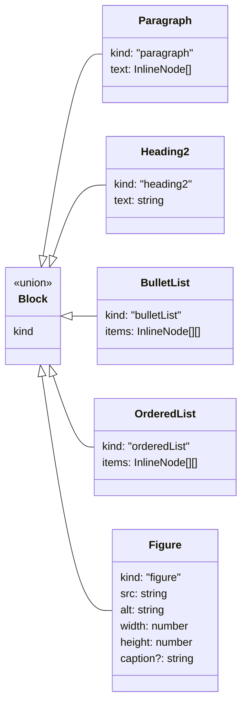
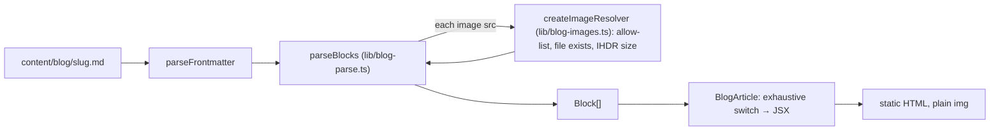

# Blog renderer

Posts are markdown files in `content/blog/<slug>.md` with `title`, `date` (YYYY-MM-DD) and
`description` frontmatter. Parsing and rendering are separate:

- `lib/blog-parse.ts` turns the body into a typed block list. It is pure (no fs, no React).
- `lib/blog-images.ts` checks every image at build time: the src must match
  `^/blog/[a-z0-9-]+\.png$` or be in `ALLOWED_IMAGE_SRCS`, the file must exist under `public/`,
  and width and height come from the PNG IHDR header. Anything else throws, so `next build` fails.
- `lib/blog.ts` reads the files and wires the two together.
- `components/BlogArticle.tsx` only maps blocks to JSX, with an exhaustive `switch` whose
  `never` default makes a new block type a compile error.

Images are plain `` with width and height, never `next/image`, so the served bytes are
the committed bytes. HTML comments are stripped; any other tag-like text renders as literal,
React-escaped text. There is no `dangerouslySetInnerHTML` in the blog path.

| Markdown | Block |
| --- | --- |
| `## Heading` | `Heading2` |
| `- item` lines | `BulletList` |
| `1. item` lines | `OrderedList` |
| `` | `Figure` |
| `*caption*` directly under an image line | `Figure.caption` (plain text) |
| anything else | `Paragraph` (inline `**bold**`, `*em*`, `[text](https://…)`, bare `https://…`) |

Tests: `src/blog-renderer.test.ts`, `src/blog-zdr-figures.test.ts`, `src/blog-backdoor-post.test.ts`.
