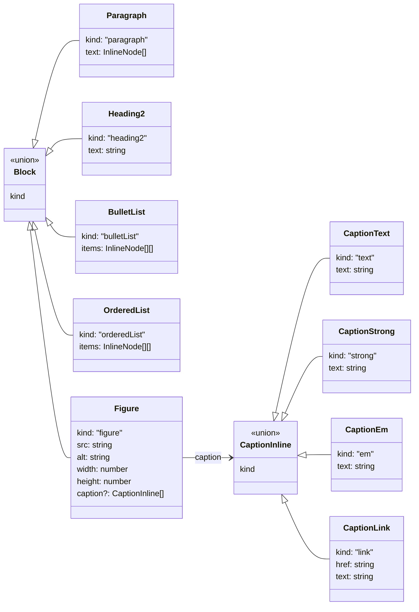
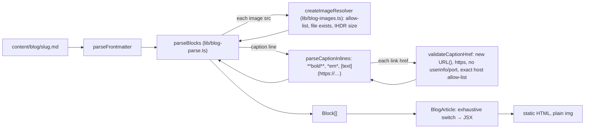

# Blog renderer

Posts are markdown files in `content/blog/<slug>.md` with `title`, `date` (YYYY-MM-DD) and
`description` frontmatter. Parsing and rendering are separate:

- `lib/blog-parse.ts` turns the body into a typed block list. It is pure (no fs, no React).
- `lib/blog-images.ts` checks every image at build time: the src must match
  `^/blog/[a-z0-9-]+\.png$` or be in `ALLOWED_IMAGE_SRCS`, the file must exist under `public/`,
  and width and height come from the PNG IHDR header. Anything else throws, so `next build` fails.
- `lib/blog.ts` reads the files and wires the two together.
- `components/BlogArticle.tsx` only maps blocks to JSX, with an exhaustive `switch` whose
  `never` default makes a new block type a compile error.

Images are plain `` with width and height, never `next/image`, so the served bytes are
the committed bytes. HTML comments are stripped; any other tag-like text renders as literal,
React-escaped text. There is no `dangerouslySetInnerHTML` in the blog path.

| Markdown | Block |
| --- | --- |
| `## Heading` | `Heading2` |
| `- item` lines | `BulletList` |
| `1. item` lines | `OrderedList` |
| `` | `Figure` |
| `*caption*` directly under an image line | `Figure.caption` (`CaptionInline[]`, see below) |
| anything else | `Paragraph` (inline `**bold**`, `*em*`, `[text](https://…)`, bare `https://…`; links pass the body link check below) |

## Figure captions (PR #43)

A caption is the `*…*` line directly under an image line (the outer asterisks are the
delimiter). Inside it, and only there, three inline forms are parsed into
`CaptionInline = CaptionText | CaptionStrong | CaptionEm | CaptionLink` (spec names:
Text | Strong | Em | Link{href,text}):

- `**bold**` → `CaptionStrong`. A caption that starts with `**…**` renders that Strong as its
  title line (``), and the rest in the body span,
  which is the pre-#40 figure markup. Any other Strong renders as `<strong>`.
- `*italic*` → `CaptionEm`, rendered `<em class="italic">`.
- `[text](https://…)` → `CaptionLink`, rendered `<a href rel="noopener noreferrer">`, no `target`.

Rules:

- **No nesting.** The content of Strong, Em and Link is plain text. Marker or HTML characters
  inside it (for example `[a *b* <i>](…)`) render literally.
- **Unmatched markers** (`**foo`, `*foo`, `[foo`, `[foo](`) become literal text. They never throw.
- **Rendering** uses React elements only: an exhaustive `switch (node.kind)` with a `never`
  check. There is no raw HTML and no `dangerouslySetInnerHTML`; JSX escapes all text.
- Body paragraphs keep their own inline rules. Only the caption line uses `CaptionInline`.

### Caption link checks (`validateCaptionHref`)

Every caption link is checked at build time. Any violation throws
`content/blog/<slug>.md:<line>: …`, so `next build` fails.

1. The raw href must not contain whitespace or control characters (tab, newline, CR). The URL
   parser would strip them silently, so this check runs on the raw text first.
2. `new URL(raw)` with no base. A scheme-relative `//evil.test` therefore throws.
3. `url.protocol === "https:"`. This rejects `http:`, `javascript:` and `data:`.
4. `url.username === ""` and `url.password === ""`, so no userinfo
   (`https://user:pw@openai.com/…`).
5. `url.port === ""`. `https://openai.com:443/…` passes because the parser normalizes the
   default port away. `https://openai.com:8443/…` fails.
6. `url.hostname` must exactly equal an entry in `CAPTION_LINK_HOSTS`. There is no suffix or
   substring matching, so `openai.com.evil.test`, `openai.com.` (trailing dot), punycode/IDN
   lookalikes (`xn--…`) and percent-encoded lookalikes fail. `https:\\evil.test` parses to host
   `evil.test` and fails. `OPENAI.COM` normalizes to `openai.com` and passes.
7. The rendered `href` is the serialized `url.href`, never the raw text.

`CAPTION_LINK_HOSTS` is a repo constant in `lib/blog-parse.ts`. **Adding a host is a spec
change** and needs a spec PR.

Current entries: `openai.com`, `platform.openai.com`, and `developers.openai.com`.

**Spec change (PR #43): `developers.openai.com` is added as an exact host.** It is the ZDR
post's source link (pre-#40 caption). Only that exact hostname matches; subdomains, suffixes
and lookalikes (`developers.openai.com.evil.com`, `sub.developers.openai.com`) still fail.

## Body links (PR #43, Blue Hat L-1)

Paragraph and list links go through `checkBodyHref` in `lib/blog-parse.ts`. The markdown
branch (`[text](href)`) and the bare-link branch (`https://…` in running text) use the same
check; neither renders an `<a>` without it.

1. A same-site path (`/…`) passes if it does not start with `//` or `/\` and holds no
   backslash or whitespace (PR #40). Everything else is an external link and runs steps 2–7.
2. The raw href must not contain whitespace or control characters.
3. `new URL(raw)` with no base must succeed.
4. `url.protocol === "https:"`. `http://developers.openai.com/` fails.
5. `url.username === ""` and `url.password === ""`. `https://user:pw@developers.openai.com/`
   and `https://user@developers.openai.com/` fail.
6. `url.port === ""` (`:443` normalizes away; `:8443` fails).
7. `url.hostname` must exactly equal an entry in `BODY_LINK_HOSTS`. No suffix or substring
   matching: `developers.openai.com.evil.com`, `sub.developers.openai.com`, a trailing dot, and a
   host named only in the path, query or fragment (`https://evil.com/?developers.openai.com`)
   all fail.

On failure the link text renders as plain text (a bare link stays its literal text); the build
does not fail, matching the existing rule for non-https links. On success the rendered `href` is
the serialized `url.href`.

`BODY_LINK_HOSTS` is a repo constant; **adding a host is a spec change.** Current entries:
`fieldsintelligence.com`, `developers.openai.com`, `x.com`, `projectdiscovery.io` (the hosts the
posts link to) and `example.com` (IANA-reserved, RFC 2606; used by the renderer tests).
It is separate from `CAPTION_LINK_HOSTS`, so body hosts do not widen what captions accept.

## Apex links from the blog host (PR #43)

Site links that must leave the blog host use `apexHref(path)` from `lib/site.ts`, which returns
`${site.url}${path}`. It is built from the `site.url` constant only, never from the request
`Host` header or the environment. The footer "Trust boundary" link is
`apexHref("/how-it-works#trust-boundary")`. `id="trust-boundary"` appears exactly once
site-wide, on the trust box (`components/TrustBoundary.tsx`) on `/how-it-works`.

Tests: `src/blog-renderer.test.ts`, `src/blog-zdr-figures.test.ts`, `src/blog-backdoor-post.test.ts`, `src/blog-caption-inline.test.ts`, `src/trust-boundary-link.test.ts`, `src/blog-body-link-hosts.test.ts`.
